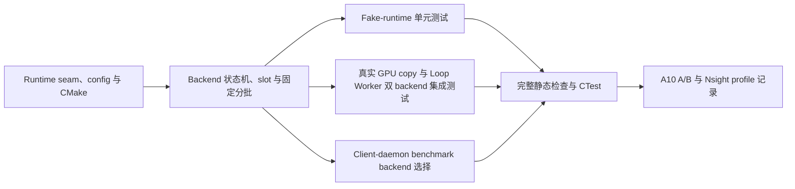

# F06-S04_CUDA Batch Copy Backend 对照实验 步骤文档

所属版本：v1

所属版本文档：[UGDR_v1 版本文档](../UGDR_v1_版本文档.md)

所属功能文档：[F06_Persistent GPU Kernel 与真实 GPU Copy 功能文档](F06_Persistent_GPU_Kernel_与真实_GPU_Copy_功能文档.md)

## 一、目标与完成条件

在不修改公开 API、WR/WC 和 Loop Worker 契约的前提下，新增可选的 `CudaBatchCopyBackend`，使用 CUDA 12.8 `cudaMemcpyBatchAsync` 替代 persistent copy kernel 进行 A/B 对照。persistent 路径继续在 NIC completion 后显式 Host flush；cuda-batch 路径要求 CPU 先确认 source-ready/NIC completion，再以 `cudaMemcpyBatchAsync` 这一后续 CUDA work submission 建立 GPUDirect RDMA ordering，不调用显式 Host flush。

完成时 fake-runtime 单元测试、真实 GPU backend 测试、同一 Loop Worker 端到端用例和 client-daemon benchmark 均可选择 cuda-batch 路径，persistent 仍是默认 backend。正确性、顺序、错误和 lifecycle 全部通过后再记录性能与 GPU profile，不以“SM-free”作为结论或验收前提。

## 二、实现设计

本步骤只新增内部 backend 和测试/benchmark 选择，不改变 `worker::CopyBackend`、`BackendRequest`、`BackendCompletion`、payload 拆分、parent WR 聚合、公开 verbs-like API 或 daemon 线上默认值。工具链最低为 CUDA 12.8 且小于 CUDA 13；persistent backend 保留并继续作为默认和回归基线。

> `cudaMemcpyBatchAsync` 的同一 batch 内各 copy 不保证执行顺序。实现不做运行时地址依赖扫描，而以 parent WR 作为固定隔离边界：一个 batch 只能包含同一 `parent_request_id` 的连续 payload，最多 64 个；不得跨 parent 合批。

### 文件与模块改动

| 文件或模块 | 改动 |
|-|-|
| `src/gpu/cuda_batch_copy_backend.hpp` | 定义 config、runtime seam、backend lifecycle、batch slot 与状态；公开面保持在 `gpu` 内部模块。 |
| `src/gpu/cuda_batch_copy_backend.cu` | 实现 CUDA stream/event/runtime 调用、按 parent WR 固定分批、提交、轮询、completion 和 drain/stop。源文件保持 CUDA language，使目标显式获得 CUDA runtime 链接。 |
| `CMakeLists.txt`、`tools/module-boundaries.json`、repository skeleton | 把新 backend 纳入 `ugdr_cuda_backend`，同步模块边界与生成文档；不放宽其他层对 GPU 模块的依赖。 |
| `tests/unit/cuda_batch_copy_backend_test.cpp` | 使用 fake runtime 确定验证调用次序、batch 分组、event 轮询、错误和 lifecycle，不要求 GPU。 |
| `tests/integration/cuda_batch_copy_backend_copy_test.cpp`、`loop_worker_cuda_test.cpp` | 验证真实 D2D copy、slot/event 生命周期，并让同一 Loop Worker Write / Write With Immediate 场景分别运行 persistent 与 cuda-batch。 |
| `benchmarks/client_daemon_cuda_benchmark.cpp` | 增加 `--backend persistent|cuda-batch`；默认 persistent，输出 backend、batch size、slot count 和 profile 参数，保留现有 smoke 默认路径并增加 cuda-batch smoke。 |

### 配置与对象模型

`CudaBatchCopyBackendConfig` 首版固定默认值为 `max_batch=64`、`slot_count=4`。runtime 在 `start()` 时创建一条 `cudaStreamNonBlocking` stream，并为每个 slot 创建一个 `cudaEventDisableTiming` event。

每个 slot 持有固定容量的 destination/source/size/attribute 数组、完整 BackendRequest 快照数组、已发布 completion 游标和状态；每个 payload 快照保留 `parent_request_id`、`parent_total_length`、`payload_offset`、`payload_length`、`payload_index` 和 `payload_count`。热路径禁止分配内存。

CUDA 参数数组必须在调用 `cudaMemcpyBatchAsync` 前填好，并保留在 slot 中直到 event 终态；BackendRequest 快照、count、completion 游标和 in-flight 序号在 batch call 与 event record 均成功后才提交。slot 在提交元数据前不进入 event 查询集合，因此 GPU 提前完成不构成竞态。每个 copy 的 attribute 使用 `cudaMemcpySrcAccessOrderStream` 和默认 flags，不设置无证据的 location hint，也不依赖 `cudaMemcpyFlagPreferOverlapWithCompute`。

### WR 与 payload 完成归属

batch event 成功只表示该 slot 中的所有 payload copy 已完成，不表示 parent WR 完成。backend 依据 slot 保存的 BackendRequest，为每个 payload 分别产生携带 `parent_request_id` 和 `payload_index` 的 BackendCompletion；slot 不维护 parent terminal bitmap，也不发布 WR-level Response 或 WC。

Loop Worker 的 ResponderInflight 继续以 `payload_count`、`terminal[payload_index]`、`results[payload_index]` 和 `terminal_count` 聚合。只有该 parent 的全部 payload 已接收时才汇总结果并产生唯一 WR-level Response；成功的 Write With Immediate 才产生唯一 Receive WC。一个 WR 可以跨多个 batch/slot，但一个 batch 不得包含多个 WR；payload 失败仍先以 payload completion 回报，最终由 Loop Worker 聚合 parent WR 失败。

### Backend 与 slot 状态

| 状态 | 允许行为与转移 |
|-|-|
| `stopped` | 没有可用 stream/event；仅允许 `start()`。启动成功后进入 accepting，部分初始化失败必须释放已经创建的资源并保持 stopped。 |
| `accepting` | 允许接受和提交 task、query event、发布 completion。`request_stop()` 后停止接受新 task 并进入 draining。 |
| `draining` | 继续提交已接受但尚未 enqueue 的尾 batch，轮询全部 in-flight event 并排空 completion；全部 slot 可复用且无 pending task 后销毁 event/stream，进入 stopped。 |

| Slot 状态 | 含义 |
|-|-|
| `free` | slot 可被保留。 |
| `preparing` | 只在填 CUDA 参数数组并执行 batch call/event record，尚未进入可查询集合。 |
| `enqueued` | 两次 enqueue 均成功，BackendRequest 快照、count、completion 游标和 in-flight 序号已经提交。 |
| `completed` | event query 成功，等待按输入顺序发布 BackendCompletion。 |
| `failed` | 提交或异步 event 错误，等待为 slot 中全部已接受请求发布 backend error。 |

只有 completed/failed slot 的 completion 全部被消费后才能回到 free。

### 固定 batch 规则

backend 按 pending BackendRequest FIFO 顺序工作。取得 free slot 后，读取队首 `parent_request_id`，直接把该 parent 的连续 payload 填入 slot 的预分配数组，遇到 parent 变化或达到 `max_batch=64` 即结束；不扫描地址区间，不分配临时容器，也不构造最长安全前缀。

现有 responder 已强制同一 parent 的 `payload_index` 从 0 连续递增、`payload_offset` 连续且总长度闭合，因此同一 WR 的目标 payload 区间互不重叠；source-source 重叠只读无影响。S04 测试和 benchmark 使用互不别名的 source MR 与 remote target MR。超过 64 个 payload 的 WR 进入后续 batch，parent 变化也强制新 batch；所有 batch 使用同一 stream，保持 batch 间和 WR 间 enqueue 顺序。event 完成后仍按 slot 中的 payload 顺序发布 BackendCompletion。

### 提交和完成顺序

若 progress 或 flush 开始时没有 free slot，先从最新到最旧 query in-flight batch event，并按 FIFO 发布已确定完成的前缀以腾出 slot；若已有 free slot，不做提交前 polling。

提交时从 pending FIFO 取得同一 parent 的连续 payload、最多 64 个的固定前缀，先填 CUDA 必需参数数组。CPU 已确认对应 source-ready/NIC completion 后，直接调用 `cudaMemcpyBatchAsync`，不调用 visibility gate 的显式 Host flush，随后立即在同一 stream 上 `cudaEventRecord`。两次调用成功后再提交 BackendRequest 快照和控制元数据，并把 slot 加入 in-flight FIFO。

每次成功提交后，从最新 in-flight event 向旧 query。若某个较新 event 已完成，单 stream order 保证其之前的全部 batch 已完成，可直接标记该完成前缀。query 始终非阻塞，对外 BackendCompletion 仍按 in-flight FIFO 与 slot 内 payload 原顺序发布。同一 batch 只记录一个 event。

```text
progress_once():
    if no free slot:
        poll_completed_prefix_newest_to_oldest()
        publish_fifo_payload_completions()
        if still no free slot: return

    while pending requests exist and a free slot exists:
        slot = reserve_free_slot_as_preparing()
        parent_id = pending.front().parent_request_id
        count = min(max_batch, consecutive_pending_count(parent_id))
        fill only CUDA argument arrays from fixed FIFO prefix
        assert source_ready_or_nic_completion_observed_by_cpu
        status = runtime.memcpy_batch_async(slot, stream)
        if status failed:
            snapshot prefix into slot for backend_error completion
            enter draining with last_error
            break
        status = runtime.event_record(slot.event, stream)
        snapshot prefix and commit slot control metadata
        remove prefix from pending
        if status failed:
            mark slot failed and require deterministic stream cleanup
            enter draining with last_error
            break
        append committed slot to in_flight FIFO
        poll_completed_prefix_newest_to_oldest()
        publish_fifo_payload_completions()

poll_completed_prefix_newest_to_oldest():
    for slot from in_flight newest toward oldest:
        status = runtime.event_query(slot.event)
        if status is not_ready: continue
        if status is success:
            mark this slot and every older slot completed
            return
        mark runtime failure and enter draining
        return
```

### 错误与停止语义

`try_submit_batch()` 只返回已经复制进 backend 有界 pending 存储的请求数。已接受后发生的 batch call、event record 或 event query 错误必须转成每个对应 task 的 BackendCompletion error。即时 batch call 失败时不 record event，并从 pending 固定前缀补齐错误 completion 所需快照。event record 失败时 copy 可能已经入 stream，必须提交对应请求元数据、标记 slot 需要确定性 stream cleanup，且在清理完成前不得复用 slot 或发布成功。首个 runtime 错误写入 `last_error` 并停止接受新请求。

cuda-batch 不调用 visibility gate；若 source-ready/NIC completion 尚未在 CPU 侧确认，则请求不具备提交条件。执行期 copy 遵循现有非原子语义，允许目标区域留下部分更新。

`request_stop()` 非阻塞，只切换到 draining。`wait()` 每次调用最多做有限 progress；尚有 pending、in-flight 或未消费 completion 时返回 `EAGAIN`。禁止用 `cudaDeviceSynchronize` 作为常规完成路径；最终资源销毁前只对私有 stream 做必要同步或通过 event 确认排空。

### 性能与命名

benchmark 至少记录 parent MWR/s、payload MTask/s、逻辑 GB/s、P50/P99、CPU 使用率、batch occupancy、event query not-ready 次数、SM Active 和 copy engine 活跃度。代码、日志和文档统一使用 `cuda-batch` 或 CUDA Batch Copy，不使用 `sm-free` 作为实现名或结论。

### 实现任务依赖



## 三、验证与验收

| 验证层 | 必须覆盖 | 通过条件 |
|-|-|-|
| Fake-runtime unit | start 部分失败回滚；无 free slot 时的 newest-to-oldest query → FIFO publish、free slot 时的 batch → record → slot metadata commit → newest-to-oldest query；每 batch 单 event；完成前缀；4 slot 背压；同 parent 的 1、63、64、65 payload；parent 变化切批；无显式 Host flush；source-ready/NIC completion 先于 batch API；无地址扫描和热路径临时分配；提交、record、query 错误；completion FIFO；request_stop/wait。 | 不要求 GPU；无丢失、重复、提前 completion 或资源泄漏；所有错误确定转成 BackendCompletion 并收敛到 stopped。 |
| Real GPU backend | 互不别名的 source/target MR；同 parent 的 1、63、64、65 payload；8 KiB 与 64 KiB；对齐/非对齐；一个 WR 跨多个 slot；两个连续 WR 进入不同 batch；尾批 drain。 | 目标 device buffer 与 host oracle 一致，event 完成前不发布成功 completion；无 CUDA 设备时按现有规则 skip 77。 |
| Loop Worker integration | 同一 fixture 分别运行 persistent 与 cuda-batch：普通 Write、Write With Immediate、多 SGE、signaled/unsignaled、RQ 消耗、WR 聚合和 backend-specific GPUDirect ordering；覆盖 WR 跨 batch/slot、多个 WR parent 隔离和部分 payload 不得提前完成。 | 两种 backend 的 Client 可观察结果一致；persistent 满足 NIC completion → Host flush → task publication，cuda-batch 满足 source-ready/NIC completion → `cudaMemcpyBatchAsync` 且无显式 Host flush；completion 不丢失、重复、跨 parent 或越过 FIFO。 |
| Client-daemon smoke | 默认 persistent smoke；新增 `--backend cuda-batch` smoke 覆盖 daemon/client/IPC/Loop Worker/真实 GPU copy。 | 两条 smoke 通过或无设备时 skip；输出明确记录 backend，不改变默认行为。 |
| Project checks | CUDA 12.8 configure/build、format/lint、module boundaries、project docs/state、完整 `ctest --output-on-failure`。 | 全部通过；CUDA 12.3 仍被最低版本检查拒绝。 |
| A10 A/B profile | 相同消息大小、payload、queue depth、warmup 和重复次数下比较两种 backend，记录 SM Active、copy engine、吞吐、P50/P99 和 CPU。 | 形成可复现实验记录；不推导 SM-free，不设置性能关闭硬阈值。 |

任何 batch 跨越 `parent_request_id`、同 parent payload 不连续、cuda-batch 在 source-ready/NIC completion 前提交或仍调用显式 Host flush、slot 元数据提交前进入 event 查询集合、event 尚未完成即发布成功、完成前缀未按 FIFO 发布、accepted request 无 completion、completion 重复或越序、drain 无法收敛、默认 backend 被改变、公开 API/WR/WC 语义变化，均视为本步骤未完成。
