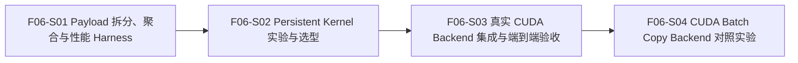

# F06_Persistent GPU Kernel 与真实 GPU Copy 功能文档

所属版本：v1

所属版本文档：[UGDR_v1 版本文档](../UGDR_v1_版本文档.md)

## 一、功能目标

使用 UGDR verbs-like API 的单机双 Client 应用和调试 GPU 数据路径的开发者，能够通过已实现的 persistent GPU kernel 完成真实 GPU buffer copy，并可选择 CUDA 12.8 的 `cudaMemcpyBatchAsync` backend 进行同契约 A/B 对照。两种 backend 都必须保证目标数据正确可见，且一个 WR 拆出的全部 payload task 完成并由 Loop Worker 聚合后，才允许产生该 WR 的成功 completion。

## 二、背景与版本关系

F05 已交付公开 posting、真实 SQ/RQ/CQ、Local Transport、两个可显式推进的 Loop Worker 和可替换 CopyBackend，并以同步 device-to-device `cudaMemcpy` 建立正确性基线。F06 直接依赖 F05，在保持公开 WR/WC 契约的前提下，把完整 WR 拆成模拟真实网络载荷的 payload task，完成 persistent kernel 的实验、选型和真实 backend 集成；在此基础上，F06-S04 新增 `cudaMemcpyBatchAsync` 对照 backend，复用同一 CopyBackend 和 completion 边界验证 runtime copy engine 路径。F07 再从公开 API 入口完成无关键路径 Mock 的完整验收。

## 三、功能范围

- 为 F05 数据路径增加可配置 payload 拆分和 WR completion 聚合；默认 payload 上限为 8 KiB，每个 payload 是一个 CUDA kernel task。
- 建立 control-only 持续负载 Harness，使用少量大型 MR 元数据的不同 offset 批量 post WR，在不执行 GPU copy 的情况下观测 parent MWR/s、payload MTask/s、逻辑 payload GB/s 和 WR 端到端延迟。
- 实现并比较多种基于 LD/ST128 的 persistent kernel；在非 warp-specialized、static/dynamic SPSC、atomic warp-specialized 与 pipeline warp-specialized 候选中，以 A10 的确定性、性能和复杂度证据完成人工选型，最终采用单 block pipeline warp specialization。
- 将选定 kernel 封装为真实 CopyBackend，接入 F05 的 Loop Worker、Local Transport 和 completion 闭环，替换 Mock GPU backend。
- 新增可选的 `CudaBatchCopyBackend`：在单条 non-blocking CUDA stream 上用有界 batch slot 和每 batch 一个 event 提交 `cudaMemcpyBatchAsync`，与 persistent backend 进行同契约 A/B；persistent backend 保持默认和基线实现。
- 覆盖普通 Write、Write With Immediate、多 SGE、对齐与非对齐、signaling、背压、错误完成、backend 生命周期和真实 GPU 数据可见性。

## 四、非目标

- 不采用 `cp.async`，不把 shared-memory staging 作为 F06 copy 主路径。
- 不实现跨主机传输、真实 NIC、wire protocol、MTU、可靠传输协议或生产级网络重传。
- 不重新定义公开 API、QP/SQ/RQ/CQ、MR 生命周期或 WR/WC 的 Client 可观察契约。
- 不扩展完整 verbs 错误恢复、QP ERR/flush、RNR timer 或 retry budget。
- 不实现生产级多 Worker 调度、负载均衡、复杂 GPU 调度策略或多 CTA 扩展；F06 最终 kernel 固定为单 persistent CTA。
- F06-S01 Harness 不执行 `cudaMemcpy` 或其他 GPU copy；真实 copy 性能在 F06-S02、F06-S03 和 F06-S04 测量。不以带宽、延迟、MWR/s 或消息大小矩阵作为 F06 关闭硬阈值，也不承担 F07 的完整公开 API 端到端验收。F06-S04 不删除 persistent backend，不把 cuda-batch 改成默认 backend。

## 五、依赖与约束

- 直接依赖 F05 的公开 posting、真实 SQ/RQ/CQ、Local Transport、Loop Worker 和 CopyBackend；继续遵守 F02 的 Write、Write With Immediate、signaling、顺序和 completion 语义。
- 构建工具链最低为 CUDA 12.8 且小于 CUDA 13；基准与选型平台为 NVIDIA A10、sm_86。A10 报告 GPUDirect RDMA writes ordering 为 `NONE`，支持 Host flush，不支持 stream-memops flush。persistent backend 在 CPU 消费对应 NIC completion 后、向已运行的 kernel release-publication task 前，必须调用并完成 `cuFlushGPUDirectRDMAWrites`。cuda-batch backend 不调用显式 Host flush：Transport 必须先在 CPU 侧确认 source-ready/NIC completion，再调用 `cudaMemcpyBatchAsync`；该后续 CPU 发起的 CUDA work submission 作为 GPUDirect RDMA ordering 边界。若无法证明 NIC 写入完成 happens-before 此 API 调用，则不得提交该 batch。
- LD/ST128 只用于源地址、目标地址均满足 16 字节自然对齐且剩余长度充足的区域；头尾和不同对齐偏移必须安全降级，禁止向下取整地址。
- payload size 是内部可配置参数，默认上限为 8 KiB，不进入公开 API。多 SGE 在 SGE 边界继续切分，使每个 kernel task 使用一个连续源区间和连续目标区间。
- `cudaMemcpyBatchAsync` 的同一 batch 内各 copy 不保证顺序。F06-S04 不做运行时地址区间扫描，而以 parent WR 作为固定边界：一个 batch 只包含同一 `parent_request_id` 的连续 payload，最多 64 个，且不得跨 WR；超过 64 个 payload 的 WR 拆成多个 batch，不同 batch 复用同一 stream。S04 测试与 benchmark 使用互不别名的 source MR 和 remote target MR。
- batch backend 只能使用显式创建的 non-blocking stream；每个 copy 的 attribute 使用 stream source-access order 与默认 flags。F06 不把该 backend 描述为或验收为“SM-free”。
- backend 接受 payload task 不代表完成；只有 parent WR 的全部 payload 到达终态并被 Loop Worker 聚合后，才能发布 WR-level Response 和成功 WC。
- 性能结果用于 kernel 选型和环境观测，不替代人工选择，也不形成版本关闭阈值。

## 六、功能设计与模块边界

发送端 Loop Worker 先按 F05 规则完整校验并解析一个 Send WR，将其 SGE 序列视为有序逻辑字节流，再按内部 payload size 切分。默认每个 payload 不超过 8 KiB；在 SGE 边界继续切分，以保证单个 payload task 只有一个连续源地址。每个 payload 携带 parent request_id、payload index、payload count、源地址、按 WR 逻辑偏移计算的连续目标地址和长度，经 Local Transport 交给接收端。

接收端按 parent WR 建立聚合状态，只为 Write With Immediate 消费一次 Receive WR，并将每个 payload 独立提交给 CUDA backend。task/completion meta queue 均有界；copy 主路径使用绕过 L1 的 LD/ST128 与安全窄访问退化。最终 kernel 采用单 block warp specialization：ingress warp 从单个 Host-visible task SPSC queue 以 lane 并行方式成批搬入 per-copy-warp shared-memory metadata pipeline，30 个 copy warp 处理各自 pipeline，egress warp 再以 lane 并行方式把结果写入单个 Host-visible completion SPSC queue；CTA 内使用 CUDA block-scope barrier/pipeline 协调，不使用 atomic claim。shared memory 仅承载 task/completion metadata，不 staging payload 数据；Host 不感知 copy warp 数量。

**已确认：**公开完成单位仍是 WR；每个 payload 是一个 kernel task；只有 parent WR 的全部 payload 到达终态后才发布一个 WR-level 结果。普通 Write 不消费远端 RQ；Write With Immediate 对整个 WR 只消费一个 Receive WR，并在成功聚合后只产生一个携带完整 WR `byte_len` 和 immediate data 的 Receive WC。任一 payload 失败时 parent WR 最终失败；RDMA Write 不保证原子更新，执行期错误可能留下部分目标更新。同一 QP 的 WR completion 与目标写入顺序必须保持已审阅契约。

**人工选型：**F06-S02 已在 A10 上完成候选矩阵、队列深度、稳定性和 payload sensitivity 实验，并由人工选择 `warp_specialized_pipeline`。单个 persistent CTA 固定为 1 个 ingress warp、30 个 copy warp 和 1 个 egress warp，共 32 个 warp；device batch 为 16，per-copy-warp shared queue depth 为 16，Host 目标 batch 为 64。Host 边界保持单 task SPSC queue 与单 completion SPSC queue，对 copy warp 数量无感；不采用多 CTA。F06-S03 必须按该模型集成，并为 Host batch 同时保留时间或可用任务数阈值，不能为凑满 64 个任务无限等待。

**CUDA Batch 对照 backend：**`CudaBatchCopyBackend` 与 `PersistentCudaCopyBackend` 并列实现既有 CopyBackend。backend 默认使用一个 non-blocking stream、4 个有界 batch slot、每 slot 最多 64 个 copy 和一个禁用 timing 的 CUDA event。若没有 free slot，progress 先从最新到最旧 query in-flight event，以单 stream 的完成前缀腾出 slot；有 free slot 时，直接选择 pending FIFO 中同一 `parent_request_id` 的连续 payload。调用前只填充 CUDA 必需参数数组；CPU 已确认 source-ready/NIC completion 后直接调用 `cudaMemcpyBatchAsync`，不做显式 Host flush，随后立即在同一 stream 上 `cudaEventRecord`。两次 enqueue 都成功后才提交 BackendRequest 快照和 slot 控制元数据，并把 slot 加入 in-flight FIFO。每次提交后再次从最新 event 向旧 query；较新 event 成功意味着其之前的 batch 均已完成，但 BackendCompletion 始终按 in-flight FIFO 与 slot 内 payload 原顺序发布。event 未就绪时不阻塞，提交或 event 错误使对应已接受 task 产生 backend error，并进入确定的 drain/stop。

> 同一个 `cudaMemcpyBatchAsync` batch 内的 copy 是无序的。因此固定 batch 不得跨 parent WR；同一 parent 内只装连续 payload。WR 超过 64 个 payload 时切到同一 stream 的后续 batch，由 stream 顺序保持先后。

## 七、步骤划分

将功能拆分为可独立设计、实现和验收的步骤。此处只定义步骤目标、交付、依赖和验收边界，不展开具体实现。

| 步骤标识 | 步骤名称 | 目标与交付 | 依赖 | 验收边界 |
|-|-|-|-|-|
| F06-S01 | Payload 拆分、完成聚合与 F05 全链路性能 Harness | 为 Loop Worker 增加默认 8 KiB、内部可配置的 payload 拆分和 parent WR completion 聚合；建立仅测控制路径和任务供给能力的持续 WR 负载源，不执行 `cudaMemcpy` 或其他 GPU copy。 | 无 | 普通 Write 与 Write With Immediate 的 WR 级语义保持不变；多 SGE、尾部 payload、背压和失败可确定验证；输出 parent MWR/s、payload MTask/s、逻辑 payload GB/s、P50/P99 和矩阵参数，且不执行 GPU copy、不把 WC 数当作 completed WR。 |
| F06-S02 | Persistent Kernel 模型实验与选型 | 实现并比较多种 LD/ST128 persistent kernel，验证 task/completion queue、对齐退化、启动停止、数据正确性和 Host 边界模型，在 A10 上形成可复现选型证据。 | F06-S01 | 非 warp-specialized、static/dynamic SPSC、atomic warp-specialized 和 pipeline warp-specialized 候选均通过确定性正确性与公平性检查；A10 证据覆盖 MTask/s、GB/s、P50/P99、资源占用、Host queue 复杂度、warp/batch/depth 扫描和 payload sensitivity。人工选型固定为 pipeline、30 copy warps（32 total）、device batch 16、shared queue depth 16、Host 目标 batch 64。 |
| F06-S03 | 真实 CUDA Backend 集成与端到端验收 | 将人工确认的 kernel 封装为正式 CopyBackend，替换 F05 Mock GPU backend，并从公开 API 验证多 payload WR 的完整真实 GPU copy 链路。 | F06-S02、pipeline 人工选型确认与本功能文档重新审阅 | 覆盖 Write、Write With Immediate、多 SGE、LD/ST128 退化、signaling、每 WR 单次 completion、背压、队列满、错误、kernel 生命周期和数据可见性；在 A10 上验证 NIC completion 后的 GPUDirect RDMA Host flush 先于 task release-publication，Host 批处理具有数量和时间/可用性双重触发；输出最终端到端观测且不设置性能关闭阈值。 |
| F06-S04 | CUDA Batch Copy Backend 对照实验 | 新增可选 `CudaBatchCopyBackend`，以单 non-blocking stream、有界 batch slot、每 batch 一个 event、提交后从最新向最旧识别完成前缀和 FIFO completion 发布接入既有 CopyBackend，并为真实 GPU 集成测试与 benchmark 增加 persistent / cuda-batch A/B 选择。 | F06-S03、CUDA 12.8 基线与本功能文档重新审阅 | 验证固定 batch 只含同一 parent 的连续 payload、64/65 边界、source-ready/NIC completion → `cudaMemcpyBatchAsync` ordering 且 cuda-batch 不调用显式 Host flush、提交后 slot 元数据提交、event 完成前缀、FIFO completion 发布、背压、错误、drain/stop、真实 GPU 数据正确性和端到端 A/B；不承诺 SM-free，也不替换 persistent 默认 backend。 |

## 八、验证与功能验收标准

- 一个 WR 被确定地拆成长度不超过配置上限的 payload task；默认上限为 8 KiB。多 SGE、非整除尾部和源/目标不同对齐偏移的数据均正确写入连续目标区域，且 parent WR 只产生一次最终结果。
- F06-S01 Harness 分别输出 parent MWR/s、payload MTask/s、逻辑 payload GB/s、WR P50/P99、payload size、queue depth、SGE 数和 signaling 间隔，且不执行 `cudaMemcpy` 或其他 GPU copy。S02 已在 A10 上形成可复现候选对照并记录 pipeline 选型：30 copy warps（32 total）、device batch 16、shared queue depth 16、Host 目标 batch 64。S03 通过专项单元测试、GPU 集成测试、GPUDirect RDMA 可见性与 flush 顺序验证、format/lint、build 和完整配置测试集。
- F06-S04 fake-runtime 测试覆盖无 free slot 时的提交前 query、free slot 时的 batch → record → slot metadata commit → newest-to-oldest query、每 batch 单 event、单 stream 完成前缀、FIFO completion、64/65 payload、parent 切批、无显式 Host flush、错误和 drain/stop。真实 GPU 测试使用互不别名的 source/target MR，并以同一 Loop Worker 用例覆盖 persistent 与 cuda-batch。
- backend 接受、单个 payload 完成或部分 payload 完成均不得提前产生成功 WC。普通 Write 不消费 RQ 且无远端 WC；Write With Immediate 对 parent WR 只消费一个 Receive WR 并产生一个包含完整 `byte_len` 与 immediate data 的 Receive WC。背压不得导致 payload 丢失、重复、越序或重复 WR completion；错误 WC 不受 signaling 抑制，执行期部分写入按已审阅非原子语义处理。
- A10 A/B 记录吞吐、P50/P99、CPU 占用、SM Active 和 copy engine 活跃度，不设置关闭硬阈值，也不据此宣称 SM-free。

## 九、风险与待确认事项

| 类型 | 内容 | 影响 | 状态 |
|-|-|-|-|
| 决策 | 最终 kernel 采用 `warp_specialized_pipeline`：单 CTA、1 ingress warp、30 copy warps、1 egress warp、device batch 16、shared queue depth 16、Host 目标 batch 64、单 task/completion SPSC queue pair。 | 固定 F06-S03 的 kernel 与 Host queue 集成边界；Host 不感知 copy warp 数量。 | 已人工确认，待本功能文档重新审阅 |
| 已接受限制 | pipeline 模型限于单 CTA，使用 38,400 B static shared memory；8 KiB 稳定结果领先，但小 payload MTask/s 显著弱于 dynamic/static SPSC。 | F06 默认 8 KiB 载荷适用；非默认小载荷与未来多 CTA 扩展不在本次选型范围。 | 已接受，S03 保留观测 |
| 约束 | A10 报告 GPUDirect RDMA writes ordering 为 `NONE`；Host flush 可用，stream-memops flush 不可用。 | NIC DMA 数据在 GPU 消费前需要明确可见性边界。 | S03 必须在 NIC completion 后、task release-publication 前完成 Host flush |
| 风险 | 固定等待 Host batch 64 可能在低负载或尾批次造成无界等待。 | 影响任务提交延迟和 drain/stop 完成。 | S03 使用数量与时间或可用任务数双重触发并验证尾批次 |
| 证据限制 | A10 应用时钟未锁定且 persistence mode 未启用；S02 使用长 warmup 与五次稳定重复。 | 不影响正确性结论，但绝对性能仍可能受频率和温度影响。 | 已记录，不作为版本关闭硬阈值 |

`cudaMemcpyBatchAsync` 在单 batch 内不保证 copy 顺序。S04 通过同一 parent 的连续 payload、最多 64 个且不得跨 WR 的固定边界避免依赖 copy 顺序，不做地址区间扫描。cuda-batch 省略显式 Host flush 的依据是 NIC 写入先对 CPU 完成，后续 CPU 发起的 CUDA work submission 建立 GPU 可见 ordering；实现必须用调用次序测试和 A10 数据正确性测试约束这一前提。最新向最旧 query 只用于识别单 stream 已完成前缀，对外 completion 仍严格 FIFO。

## 十、变更记录

| 日期 | 变更内容 | 变更原因 | 影响范围 |
|-|-|-|-|
| 2026-07-23 | 基于 UGDR_v1 版本文档和 F05 已审阅实现边界创建 F06 功能文档草稿，确定三步线性拆分。 | F05 已完成人工验收，F06 是版本依赖链中的下一功能。 | 功能目标、范围、依赖、设计、步骤 DAG、验收和风险。 |
| 2026-07-23 | 将 backend 粒度从整 WR 单任务调整为默认 8 KiB payload task，并增加 parent WR completion 聚合与 MWR/s、MTask/s、GB/s 分离口径。 | 模拟真实网络载荷，向 persistent kernel 提供持续任务，同时保持公开 WR/WC 完成语义。 | F06-S01 至 F06-S03、Loop Worker、Local Transport、CopyBackend、性能 Harness 和验收矩阵。 |
| 2026-07-23 | 排除 `cp.async`，固定 LD/ST128 主路径与安全窄访问退化；将 F06-S01 Harness 固定为 control-only，排除 `cudaMemcpy` benchmark；最终 warp specialization 模型留待 A10 实验和人工选择。 | `cp.async` 需要 shared-memory staging，不适合作为本功能纯 global-to-global copy 的首选路径；S01 只测 payload 拆分、聚合和 F05 control path，避免同步 GPU copy 污染任务供给基线。 | F06-S01 性能 Harness、F06-S02 候选模型、功能设计、依赖约束和风险。 |
| 2026-07-30 | 基于 A10 实验人工选择 pipeline warp specialization：30 copy warps（32 total）、device batch 16、shared queue depth 16、Host 目标 batch 64、单 task/completion SPSC queue pair、单 CTA；补充 GPUDirect RDMA Host flush 和 Host batch 双触发约束。 | pipeline 在默认 8 KiB 载荷上取得最佳稳定结果，同时保持 Host 对 copy warp 数量无感；A10 不提供原生 GPUDirect RDMA write ordering，需要显式 Host flush。 | F06-S02 结论、F06-S03 集成边界、依赖约束、验证标准和风险。 |
| 2026-08-11 | 新增 F06-S04 CUDA Batch Copy Backend 对照实验，并把 CUDA 工具链约束更新为 12.8。 | 在 persistent backend 基线上验证 runtime copy engine 路径。 | 功能目标、范围、约束、步骤 DAG、验证与风险。 |
| 2026-08-12 | 固定 batch 改为同一 parent 连续 payload、最多 64 个；提交后从最新 event 向旧识别完成前缀；依据 CPU work-submission ordering 移除 cuda-batch 显式 Host flush。 | 避免运行时地址扫描，利用单 stream 顺序，同时保留 FIFO completion。 | F06-S04 设计、验收与风险。 |
