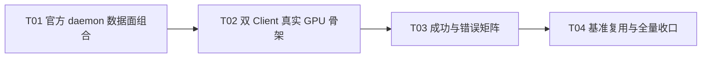

# F07-S01_公开 API 无 Mock 端到端验收闭环 步骤文档

**所属版本文档：** [UGDR_v1 版本文档](../UGDR_v1_版本文档.md)

**所属功能文档：** [F07_公开 API 端到端验收 功能文档](F07_公开_API_端到端验收_功能文档.md)

**所属版本：** v1

**功能标识：** F07-公开 API 端到端验收

**步骤标识：** F07-S01-公开 API 无 Mock 端到端验收闭环

# 一、目标与完成条件

完成 F07 的唯一实现步骤：让官方 `ugdr_daemon` 承载默认 Persistent Backend 数据路径，并由两个独立 Client 进程仅通过公开 API，在真实 GPU 上闭环验证 RDMA Write 与 RDMA Write With Immediate。

当成功与错误矩阵全部通过、成功 WC 只在真实 GPU copy 完成后可见、失败场景不修改目标数据，且全量构建/测试/治理门禁通过时，本步骤完成；关键路径不得使用 mock，也不设置性能达标阈值。

# 二、实现设计

## 已确认约束与来源事实

- 验收拓扑固定为“官方 `ugdr_daemon` + 两个独立 Client 进程 + 真实 GPU”；测试进程间的带外管道只负责交换 QP/MR 元数据和汇总断言，不替代 UGDR 控制面或数据面。
- 范围只收口已经审阅的 v1 公开 API 与 RDMA 语义：QP 包含 SQ/RQ，应用投递 Send/Receive WR，CQ 返回 WC；不新增公开 API，不扩展到双主机、NIC 数据面或完整生产故障注入。
- 官方 daemon 默认且仅以 Persistent Backend 完成本步骤的数据 copy；CUDA Batch Backend 继续作为既有对照实验，不改变默认路径。
- RDMA Write 不消耗远端 Receive WR；RDMA Write With Immediate 必须消耗且只消耗一个已投递 Receive WR，并产生对应接收 WC。未请求 signaling 的成功发送不产生本地成功 WC。
- 成功发送 WC 只能在 GPU copy 真正完成后发布；RNR、非法/过期 rkey、越界和错误 QP 状态必须给出确定性失败，且目标数据与 guard 区保持不变。
- 当前代码事实：`apps/daemon/main.cpp` 只轮询控制 IPC；真实 Loop Worker + Persistent Backend 组合存在于 GPU 集成测试和 `benchmarks/client_daemon_cuda_benchmark.cpp` 的私有服务中，但尚未进入官方 daemon，也尚未形成两个独立 Client 的公开 API 数据面验收。

## 文件与模块改动

| 位置 | 设计改动 |
|-|-|
| `apps/daemon/data_service.hpp`、`apps/daemon/data_service.cpp` | 新增 daemon 内部数据服务。引用 `QpService`，管理 `LocalTransport`、默认 `PersistentCudaCopyBackend` 和每个已建连 QP 的 `LoopWorker`；不暴露新的 Client ABI。 |
| `apps/daemon/main.cpp` | 在现有控制面轮询旁驱动数据服务；按“停止接收新工作 → drain backend/worker → 发布终态 → 释放资源”顺序关闭。 |
| `src/control/qp.hpp`、`src/control/qp.cpp` | 提供最小的内部已建连 QP 枚举/快照能力，使 daemon 按真实 session/QP 关系创建和撤销 worker；不得依赖固定 QPN 范围扫描。 |
| `CMakeLists.txt` | 将数据服务编入 `ugdr_daemon`，并增加 daemon 到 `ugdr_cuda_backend` 的显式链接。 |
| `tools/module-boundaries.json`、`docs/architecture/repository-skeleton.md` | 同步新增的生产依赖边与生成架构段。 |
| `tests/integration/public_api_cuda_acceptance_test.cpp` | 新增真实 daemon、两个角色化 Client 子进程和真实 GPU 的公开 API 综合验收。 |
| `tests/integration/CMakeLists.txt` | 注册 `ugdr_public_api_cuda_acceptance`，传入真实 `ugdr_daemon` 路径，并保留 GPU 环境的既有 skip 契约。正式 F07 验收必须实际 PASS，SKIP 不算通过。 |
| `benchmarks/client_daemon_cuda_benchmark.cpp` | Persistent 模式改为启动官方 daemon，复用同一生产路径；保留 CUDA Batch 对照模式和现有观测字段，不增加性能门槛。 |

## 运行时流程

```python
def daemon_main():
    memory = RuntimeCudaIpcMemoryBackend()
    control = QpService(memory)
    data = DaemonDataService(control, backend="persistent")
    server = IpcServer(ControlIpcHandler(control))

    while not stopping:
        server.poll_once(nonblocking_timeout)
        data.reconcile_connected_qps()
        data.progress_once()

    server.stop_accepting()
    data.drain_and_publish_terminal_completions()
    server.close_sessions()


def acceptance_supervisor():
    daemon = spawn_real_ugdr_daemon(temp_socket)
    responder = spawn_client_process(role="responder", socket=temp_socket)
    requester = spawn_client_process(role="requester", socket=temp_socket)

    # 侧信道只交换应用本来就需要交换的连接信息与测试结果。
    exchange_qp_and_mr_metadata(requester, responder)
    run_success_and_error_matrix(requester, responder)
    require_all_children_cleanly_destroy_objects_and_exit()
    stop_daemon_and_require_clean_drain(daemon)
```

数据服务以 `(session_id, qp_num)` 作为本地 worker 身份，以受控 QP 快照中的 `peer_qp_num` 建立 transport 对端。QP 首次进入 RTS 后创建 worker；重复 reconcile 必须幂等；session 断开、QP 销毁或状态失效时停止对应 worker 并清除 transport 注册。控制轮询与数据 progress 都必须有界，不能让空闲 QP 阻塞其他 session。

## 验收行为矩阵

| 场景 | 必须观察到的结果 |
|-|-|
| Signaled RDMA Write，shared CQ 与 split CQ | 目标 GPU 数据完全匹配，前后 guard 不变；不消耗 RQ；本地发送 WC 的 `wr_id/opcode/status/byte_len/qp_num` 与契约一致。 |
| Unsignaled RDMA Write | copy 完成并可由测试同步确认，但本地 CQ 不出现成功发送 WC。 |
| Signaled/unsignaled RDMA Write With Immediate | 预投递的一个 Receive WR 被精确消费；远端接收 WC 携带正确 `wr_id/opcode/status/byte_len/imm_data/qp_num`；本地成功 WC 只遵循 signaling。 |
| RNR | 未投递 Receive WR 的 Write With Immediate 失败；目标数据、guard 和 RQ 状态不被伪造为成功。 |
| 非法 rkey、注销后的 stale rkey、远端越界 | 返回对应远端访问失败；目标与 guard 不改变，不产生远端成功 WC。 |
| 错误 QP 状态或错误 peer | 在公开 API/既有状态机规定的边界确定性失败，不投递到 backend，不产生成功 WC。 |
| child-first 与 daemon shutdown | Client 正常 destroy/exit 后 daemon 可 drain；daemon 不悬挂、不泄漏 CUDA IPC 映射、不留下半完成成功。 |

每个成功场景都先写入不同的目标 sentinel 与 guard，完成后由目标 Client 在本进程 GPU 上回读；错误场景复用同样的前后快照证明“未修改”。测试不得读取 daemon 私有内存来替代公开可见结果。

## 实现任务

| 任务 | 交付 | 依赖 |
|-|-|-|
| T01 官方 daemon 数据面组合 | 内部 QP 枚举、`DaemonDataService`、Persistent Backend、Loop Worker 生命周期和有界 progress 接入官方 daemon；同步生产依赖边。 | 无 |
| T02 双 Client 真实 GPU 骨架 | 新增 supervisor/两个 Client 角色，完成公开 API 对象创建、带外元数据交换、真实 daemon 启停和 clean drain。 | T01 |
| T03 成功与错误矩阵 | 覆盖 Write、Write With Immediate、Receive WR、signaling、shared/split CQ、WC 字段、RNR、rkey、越界、stale MR 与 QP 状态。 | T02 |
| T04 基准复用与全量收口 | Persistent benchmark 走官方 daemon；完成专项、全量和治理验证，记录真实 GPU 证据但不设置性能阈值。 | T03 |



# 三、验证与验收

| 验证动作 | 预期结果 | 失败判定 |
|-|-|-|
| 构建并运行 `ctest --test-dir build -R '^ugdr_public_api_cuda_acceptance$' --repeat until-fail:5 --output-on-failure` | 五轮均由官方 daemon 和两个独立 Client 在真实 GPU 上实际 PASS；成功/错误矩阵、WC 字段、数据与 guard 全部一致。 | 任一轮失败、超时、进程异常退出，或正式验收结果为 SKIP。 |
| 分别运行 `ctest --test-dir build -R '^ugdr_loop_worker_cuda$' --output-on-failure` 和 `ctest --test-dir build -R '^ugdr_client_daemon_cuda_benchmark_smoke$' --output-on-failure` | 既有真实 GPU 数据面和 Persistent benchmark 回归通过，benchmark 显示使用官方 daemon；只记录观测值。 | 语义回归、仍走 benchmark 私有 Persistent 服务，或以性能数值未达阈值作为失败。 |
| 运行 `tools/ugdr format --check`、`tools/ugdr lint`、`tools/ugdr build` 和 `ctest --test-dir build --output-on-failure` | 格式、静态检查、完整构建与已配置测试全部通过；非 F07 的既有环境 skip 契约不漂移。 | 任一命令失败，或新增非预期 skip/回归。 |
| 运行 `python3 tools/check_client_contracts.py --root .`、`python3 tools/check_module_boundaries.py --root . --build-dir build`、`python3 tools/check_project_docs.py --root .`、`python3 tools/project_state.py validate --root .` 和 `git diff --check` | 公开契约未扩张，daemon→CUDA backend 边与骨架文档一致，文档和机器状态合法，diff 无格式错误。 | ABI/契约漂移、依赖越界、生成架构段不同步、状态或文档治理失败。 |
| 检查 `docs/progress/F07-S01.md` | 记录测试命令、真实 GPU 型号/环境、PASS 非 SKIP 结果、关键行为矩阵与无性能阈值结论。 | 缺少真实 GPU 执行证据，或仅以 commit/PR/测试存在推断人工验收。 |

最终“已实现”和人工验收仍由人确认；测试通过、提交或 PR 均不得自动勾选步骤/功能文档中的人工待办。
