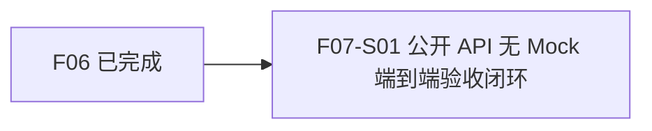

# F07_公开 API 端到端验收 功能文档

所属版本：v1

所属版本文档：[UGDR_v1 版本文档](../UGDR_v1_版本文档.md)

## 一、功能目标

UGDR 使用者与维护者能够在单机双 Client 进程加正式 Daemon 的真实 GPU 环境中，仅通过公开 API 完成一条无 Mock 的 RDMA 端到端链路；以 GPU 数据复制结果、标准 WC/错误语义和可重复自动化验收共同判定目标实现。

## 二、背景与版本关系

F07 承接已完成的 F02–F06，是 UGDR_v1 的最终公开 API 验收功能。现有分层测试和数据路径基准已分别验证对象模型、队列、Loop Worker 与真实 GPU Copy，但尚需由正式 Daemon 和两个独立 Client 进程把公开 API→IPC→控制面→SQ/RQ/CQ→Datagram→Loop Worker→GPU Kernel 串成可重复验收的完整链路。

## 三、功能范围

- 在 `ugdr_daemon` 中组合既有控制面、SQ/RQ/CQ、本地 Datagram、Loop Worker 与默认 Persistent GPU Backend，统一管理启动、推进、排空和关闭。
- 两个独立 Client 进程仅使用公开 API 创建与连接对象、注册真实 GPU MR、投递 Send/Receive WR 并轮询 WC。
- 覆盖 RDMA Write、RDMA Write With Immediate、Receive WR 消耗、signaled/unsignaled、共享 CQ 与拆分 CQ，并校验目标数据、保护区和 WC 字段。
- 覆盖 RNR、无效 rkey、越界访问、过期 MR、错误 QP 状态等必要路径，校验稳定错误映射且失败不得修改目标缓冲区。
- 形成可由 CTest 调度的端到端验收测试与必要测试夹具，验证正常退出和资源清理。

## 四、非目标

- 不扩展到双机、真实 NIC 或跨主机网络验收。
- 不新增公开 API、公开 ABI 或超出 UGDR_v1 已审阅契约的能力。
- 不把 CUDA Batch 改为默认 Backend，也不重新设计 F02–F06 已确认的内部模块。
- 不承担完整 CI/CD、生产级故障注入或运维体系建设。
- 不设置性能收口阈值；性能数据只作观察与回归线索，不作为 F07 完成条件。

## 五、依赖与约束

- F02–F06 已完成，尤其依赖 F06 的 Persistent GPU Kernel 与真实 GPU Copy 语义。
- 验收主机必须具备项目支持的 CUDA 12.8+ 环境和真实可用 GPU；正式验收不得以 GPU 缺失跳过代替通过。
- 公开边界遵循标准 RDMA/libibverbs 术语、对象关系、QP 状态、WR/WC、signaling、Receive WR 消耗及 RDMA Write 与 Write With Immediate 的差异。
- 成功 WC 只能在真实 GPU Copy 完成后产生；关键路径不得使用 Mock。
- 保持 Client、Daemon、队列、Datagram、Loop Worker 和 GPU Backend 的既有依赖方向，不绕过公开 API 构造验收结果。

## 六、功能设计与模块边界

正式 `ugdr_daemon` 承载既有控制服务和真实数据面服务，负责会话、对象、队列、传输、Worker 与 GPU Backend 的生命周期以及错误传播；Client 只通过已审阅公开 API 和共享队列参与。

请求端 Client 投递 Send WR，Daemon 的请求端 Loop Worker 消费 SQ 并生成本地 Datagram；响应端按 QP/MR/RQ 状态校验后提交 Persistent GPU Copy，GPU 完成元数据由 Loop Worker 汇聚并按 signaling 与操作类型生成 WC。

普通 Write 不消耗远端 Receive WR；Write With Immediate 必须消耗 Receive WR 并产生对应远端完成。RNR、rkey、边界、MR 生命周期或 QP 状态失败均走确定性错误路径，不得提前发布成功 WC，也不得修改目标内存。

**已确认：**F07 采用一个步骤完成；默认 Persistent Backend、真实 GPU Buffer、正式 Daemon、两个独立 Client 进程和关键路径无 Mock。允许新增测试编排与夹具，但不得把测试旁路变成生产数据路径，也不改变公开 API。

## 七、步骤划分

F07 仅拆分一个可独立实现和验收的步骤；功能外部前置为 F06 已完成。

| 步骤标识 | 步骤名称 | 目标与交付 | 依赖 | 验收边界 |
|-|-|-|-|-|
| F07-S01 | 公开 API 无 Mock 端到端验收闭环 | 把既有真实数据面集成到正式 Daemon，交付双 Client 进程、真实 GPU、默认 Persistent Backend 的可重复端到端验收测试。 | 无功能内前置；功能外依赖 F06 已完成。 | 公开 API 全链路不使用 Mock，成功与必要错误矩阵通过，完成时序、数据保护、资源清理及全量项目检查均符合审阅契约。 |

## 八、验证与功能验收标准

- 在真实 GPU 验收主机上启动正式 Daemon 和两个独立 Client 进程，公开 API 路径完整经过 IPC、控制面、SQ/RQ/CQ、Datagram、Loop Worker 与 Persistent GPU Kernel；覆盖 Write、Write With Immediate、Receive WR 消耗、signaled/unsignaled、共享/拆分 CQ，并逐字节校验目标数据与保护区。
- 通过项目要求的 format/lint、配置与构建、Client 契约、模块边界、文档治理、项目状态校验及完整 CTest；端到端用例可重复执行且正常完成进程退出与资源回收。
- RNR、无效 rkey、越界、过期 MR、错误 QP 状态等路径返回确定性错误/WC；失败不修改目标缓冲区，unsignaled 不产生本地成功 WC，任何成功 WC 均不得早于真实 GPU Copy 完成。性能仅记录观察值，不设置通过阈值。

## 九、风险与待确认事项

| 类型 | 内容 | 影响 | 状态 |
|-|-|-|-|
| 风险 | 把现有验收/基准中的真实数据面组合迁入正式 Daemon，可能耦合控制面与数据面的启动、排空和错误生命周期。 | 若生命周期边界不清晰，会造成挂起、提前完成或资源泄漏。 | 已确认：以显式启动、排空、错误传播和清理测试约束。 |
| 风险 | 真实 GPU、CUDA 环境与计数器可用性存在主机差异。 | 可能影响用例可运行性或性能观测稳定性。 | 已确认：正确性验收必须使用真实 GPU；性能和计数器不作收口门槛。 |
| 待确认 | 无。 | 当前功能边界和单步骤拆分已确认。 | 已确认 |

## 十、变更记录

| 日期 | 变更内容 | 变更原因 | 影响范围 |
|-|-|-|-|
| 2026-10-11 | 基于 UGDR_v1 版本文档创建 F07 功能文档，确认单步骤最小闭环方案。 | 承接 F06 完成状态，补齐 v1 公开 API 端到端验收功能。 | F07 功能边界与 F07-S01 步骤划分。 |
